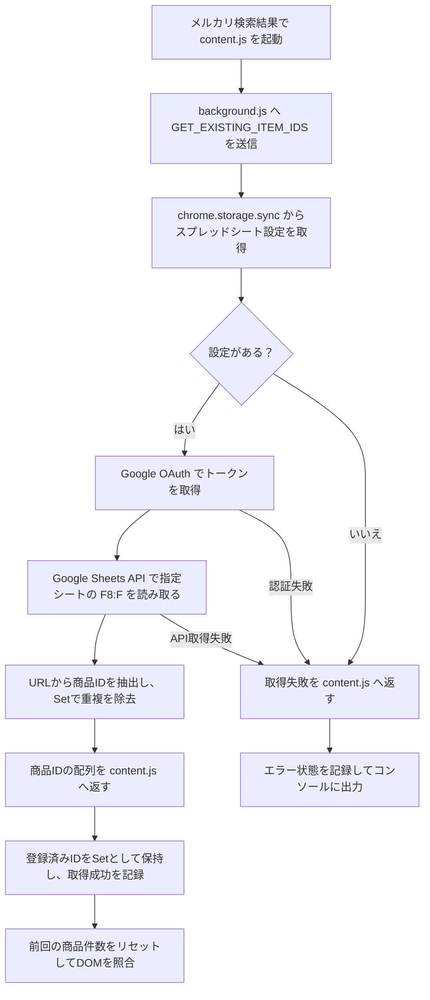
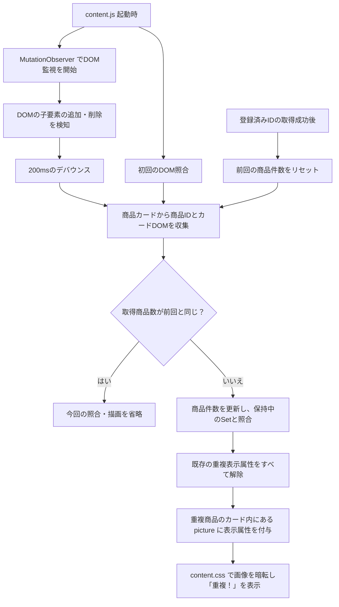

# LG Mercari Duplicate Checker

メルカリの検索結果に表示されている商品をGoogleスプレッドシートの登録済みURLと照合し、重複商品を検索画面上で視覚的に判別できるChrome拡張機能です。

## 目的

商品リサーチ時に発生していた、

1. メルカリで商品を確認する
2. Googleスプレッドシートを開く
3. 過去に登録済みの商品か確認する
4. メルカリへ戻る

という反復作業を削減します。

登録済みの商品は検索結果の商品画像を暗くし、画像中央に **「重複！」** と表示します。

## 主な機能

- メルカリ検索結果ページを自動判定
- 検索結果DOMから商品情報を取得
- 動的に追加される商品を `MutationObserver` で監視
- Google OAuthによるユーザー認証
- Google Sheets APIによる登録済みURLの読み取り
- 商品URLからメルカリ商品IDを抽出
- `Set` を利用した重複判定
- 重複商品の画像へオーバーレイ表示
- スプレッドシートURL / IDとシート名を設定画面から変更可能
- 設定値を `chrome.storage.sync` に保存

## 処理フロー

### 登録済み商品IDの取得



### DOMの監視・照合・重複表示



- 登録済みIDの取得とDOM監視は並行して進みます。取得前は空のSetで照合し、取得成功後に件数チェックをリセットして再照合します。
- DOM変更時は保持中のSetを再利用し、Sheets APIを再実行しません。現在の実装では、商品が入れ替わっても取得商品数が同じなら描画を省略します。
- 表示属性は `data-lg-duplicate="true"` です。カード内に `picture > img` が見つからない商品は属性付与をスキップします。
- 取得失敗や表示状態は、後述のPopupの自己診断で確認できます。

## 構成

```text
lg-mercari-duplicate-checker/
├── manifest.json
├── README.md
└── src/
    ├── background.js
    ├── content.js
    ├── content.css
    ├── services/
    │   ├── sheets.js
    │   └── storage.js
    └── options/
        ├── options.html
        ├── options.js
        └── options.css
```

### ファイル責務

| ファイル              | 責務                                            |
| --------------------- | ----------------------------------------------- |
| `manifest.json`       | Chrome拡張の構成・権限・OAuth設定               |
| `content.js`          | メルカリDOMの監視・商品取得・重複判定・画面反映 |
| `content.css`         | 重複商品の視覚表示                              |
| `background.js`       | content scriptとGoogle Sheets間の橋渡し         |
| `services/sheets.js`  | Google認証・Sheets API・商品ID変換              |
| `services/storage.js` | 拡張設定の保存・取得                            |
| `options/options.js`  | 設定画面のUI制御                                |

## Google Sheets

現在のMVPでは、商品URL列を以下に固定しています。

```text
F8:F
```

スプレッドシートとシート名は拡張機能の設定画面から変更できます。

対象URL例：

```text
https://jp.mercari.com/item/m12345678901
```

URL全文ではなく、以下の商品IDを抽出して重複判定します。

```text
m12345678901
```

## 技術

- Chrome Extensions Manifest V3
- Vanilla JavaScript
- Chrome Identity API
- Chrome Storage API
- Google OAuth 2.0
- Google Sheets API
- MutationObserver

## 設計方針

### DOMは意味のある属性を優先する

生成されたCSS classには依存せず、主に以下を利用します。

```text
li[data-testid="item-cell"]
a[data-testid="thumbnail-link"]
[data-testid="thumbnail-item-name"]
```

### 固定時間待ちに依存しない

メルカリの商品はJavaScriptによって動的に描画されるため、固定の `setTimeout` で描画時間を推測せず、`MutationObserver` でDOM変更を検知します。

### Sheets APIを無駄に呼ばない

登録済み商品IDはページ開始時に取得して `Set` として保持し、DOMが追加されるたびにSheets APIを再実行しません。

## Popupの自己診断

拡張機能のアイコンをクリックすると、その時点の検索画面を読み取り専用で検査します。
取得済みのSheets結果を使うため、Popupの開閉による認証・Sheets APIの追加呼び出しはありません。
追加権限や常時ポーリングもありません。オプションを変更・接続確認した後は検索画面を再読み込みしてください。

- **正常**：Sheets取得成功で、重複商品の表示属性と検査したCSS条件が一致。
- **要確認**：Sheets取得失敗、商品ID取得の欠落、表示属性の不足・余分な付与、CSS条件の不一致。
- **確認中・判定不能**：取得中、商品0件、重複0件など。カード自体がない場合、結果0件とDOM変更は区別できません。
- **対象外**：検索画面以外、またはcontent scriptに接続できない状態。

CSS検査は疑似要素の文字・色・暗転色・配置・可視性・重なり順・クリック透過などの計算済みスタイルを確認します。
他の要素による遮蔽など、実際の見た目を完全には保証しません。
Sheetsのエラーは受信内容を表示しますが、認証・設定・APIの原因を常に自動特定できるわけではありません。
同じ商品件数で再描画を省略する既存仕様は維持しています。診断では現在DOMを読み直すため、未反映の属性を検出できます。

### 手動確認手順

1. `chrome://extensions` で拡張機能を再読み込みし、メルカリ検索画面も再読み込みする。
2. 重複がある画面でPopupを開き、商品数・重複数・属性数と「正常」を確認する。重複の暗転・文字・商品リンク操作も確認する。
3. DevToolsで重複画像の `data-lg-duplicate` を削除し、Popupを開き直して「要確認」と属性不足を確認する。
4. 画面を再読み込みし、DevToolsで疑似要素の文字や色を上書きして、PopupがCSS不一致を検出することを確認する。
5. 重複0件・検索結果0件では「確認中・判定不能」、別サイトでは「対象外」を確認する。
6. 未接続の環境または無効な設定で検索画面を再読み込みし、Sheets取得失敗とオプションへの案内を確認する。確認後は設定を戻す。
7. 拡張機能のService WorkerのNetworkログで、Popupの開閉を繰り返してもSheetsリクエストが増えないことを確認する。

## MVPの範囲

現在は以下をMVPとしています。

- Google Sheets読み取り
- メルカリ通常商品の重複判定
- 検索結果への重複表示
- スプレッドシート設定の保存

今後必要になった場合にのみ、URL列の可変化、ショップ商品の対応、UI改善などを追加します。
